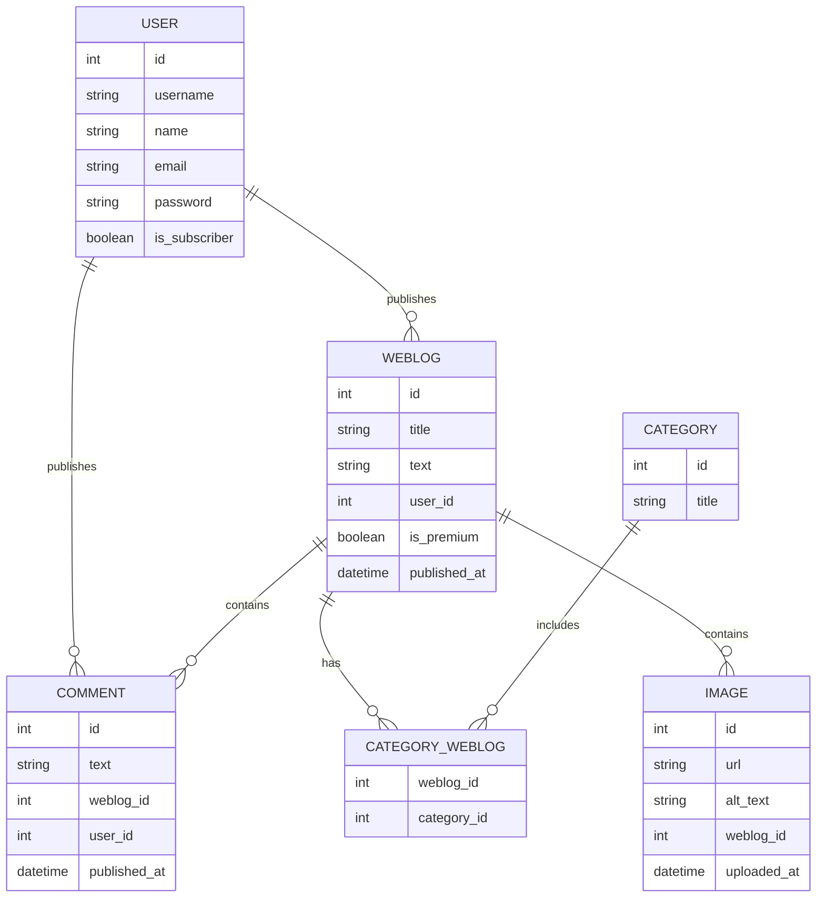

# database

Toelichting:

- `users.username` en `users.email` zijn uniek; `email` is nullable, omdat registratie alleen een gebruikersnaam en wachtwoord vraagt.
- `users.is_subscriber` is een boolean met standaardwaarde `false`.
- `weblogs.published_at` is geïndexeerd; `weblogs.is_premium` is een boolean met standaardwaarde `false`.
- `category_weblog` heeft een samengestelde primaire sleutel (`weblog_id`, `category_id`).
- Alle foreign keys hebben cascade-delete, zodat comments, afbeeldingen en categorie-koppelingen met het artikel verdwijnen.
